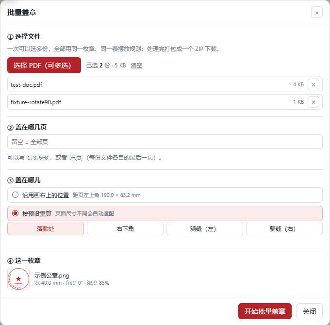
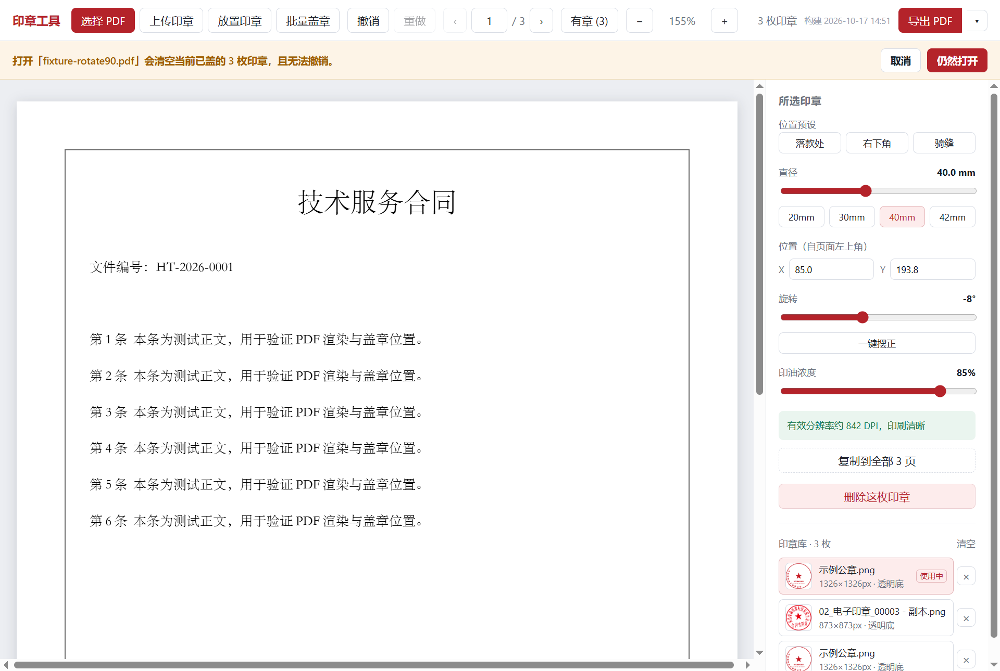
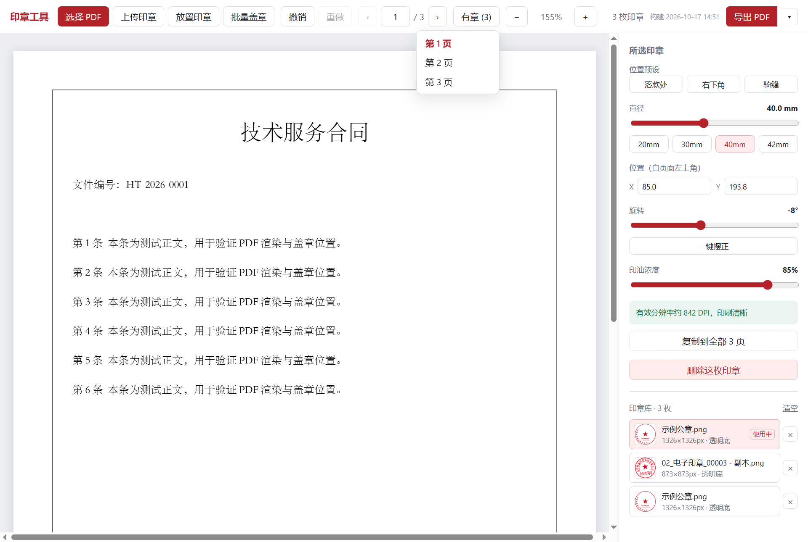

# 印章工具 · 轻量 PDF 盖章

把一枚背景透明的公章图片，经拖拽/缩放/旋转后盖到 PDF 的任意位置，导出仍是**原文档 + 一枚图**：
文字还是文字、字体还是原字体、矢量零损失。也可以**一次给多份文件批量盖章**（同一枚章、
同一套摆放规则，最后打包成一个 ZIP）。全部处理在本地浏览器/WebView 内完成，文件不上传。

打包成单文件 exe 的流程与已知环境坑见 [README-打包.md](README-打包.md)；
最初的架构推导见 [docs/设计文档.md](docs/设计文档.md)，
首轮代码审查与修复清单见 [docs/优化建议-首轮.md](docs/优化建议-首轮.md)。

## 常用命令

```bash
npm install
npm run dev          # 开发（默认 5173；打包脚本用的是 5183）
npm run build        # tsc -b && vite build → dist/
npm test             # vitest，纯逻辑回归（秒级）
npm run tauri build  # 打包 exe（产物在 src-tauri/target/release/）
npm run fixtures     # 重新生成并自检「旋转页 / 裁切框」测试夹具
```

## 四条不能破的架构决策（另有 3 条踩坑之后补的，见下）

1. **编辑期不改文档像素**：预览是 pdf.js 渲染的 canvas + 一个绝对定位的 ``，
   导出是 pdf-lib 往原内容流追加一次 `drawImage`。因此不需要 Konva/Fabric，
   也不需要为了预览去重渲染整页。推论：**导出质量恒 ≥ 预览质量**。
2. **白纸底 ⇒ alpha ≡ 正片叠底**，所以不注入 `/BM /Multiply` 的 ExtGState
   （`src/lib/exporter.ts` 顶部有推导）。
3. **印章有法定物理尺寸 ⇒ 一律用 PDF point 存储**，界面按 mm 显示
   （`src/lib/units.ts` 是唯一换算真源）。
4. **文档不可变 ⇒ 撤销是快照栈**，只存印章数组（`src/state/reducer.ts`）。

### 第 5 条（踩过坑之后补的）：页面几何以 pdf.js 为唯一真源

预览与导出看的**不是同一个坐标系**：

| | 预览（pdf.js getViewport） | 导出（pdf-lib drawImage） |
|---|---|---|
| /Rotate | 应用 | 不认识 |
| 边界 | 裁切框 CropBox | MediaBox |
| /UserUnit | 计入 | 不暴露 |

所以印章坐标一律按**显示空间**（预览里那张纸，左上原点）存储，导出前经
`src/lib/pageSpace.ts` 的 `displayToUser()` 换算成用户空间；页面帧
（`view` / `rotation` / `userUnit`）由 `pdfReader.readPages()` 在载入时采集，
随 `PdfHandle.pages` 一路传到 `stampDocument()`。

不这么做会怎样（栅格化后实测印迹落点）：

| 页面 | 旧实现的后果 |
|---|---|
| `/Rotate 90` + 居中 | 偏 **43.4mm** |
| `/Rotate 90` + 右下角预设 | 印迹**整个掉到可见页面之外**（导出文件里看不见章） |
| `/Rotate 90` + 落款处预设 | 偏 (+91.9, −105.1)mm |
| CropBox 四周内缩 20pt | 恒定偏 **7.2mm** |

而**预览全程正常**——用户要打开导出文件才会发现。扫描件靠 /Rotate 摆正、
印刷稿常带裁切框，这两种页面在真实文件里非常常见。

### 第 6 条：印章去背分两条路线，**别相信翻拍件的 alpha**

早期只有一条路线：把「alpha>0 但 RGB≈白」的像素置透明——这只对**规范的透明底 PNG** 成立。
真实用户交上来的多半是**手机翻拍 / 微信转存的照片**：整张图没有真正的透明像素，
或者 alpha 被抠图工具写成整片半透明。这时半透明的墨直接盖在合同上，
**底下的字会透上来**，看起来就是「重影」。

现在的分流规则（[sealPixels.ts](src/lib/sealPixels.ts)）：

| 输入 | 判据 | 做法 |
|---|---|---|
| 规范透明 PNG | 有 ≥2% 的全透明像素 | 尊重源 alpha，只清白色毛边 |
| 翻拍 / 扫描件 | 几乎没有全透明像素 | 按颜色反推墨量 `α = 距纸色距离 / 纸→墨距离`，再把颜色**反预乘**回实心墨色 |

反预乘保证「合成回白纸 ≡ 原照片」（`tests/sealPixels.test.ts` 里就是用这个往返等式做断言），
于是纸的地方真透明、墨的地方实心，不会把合同上的字带出来。
这类章默认浓度给 **1.0** 而不是 0.85：照片本身已带真实印迹的浓淡，再乘一次透明度只会让字透上来
（见 [geometry.ts](src/lib/geometry.ts) 的 `defaultOpacity`）。

实例对照：[testdata/ghost-before-after.png](testdata/ghost-before-after.png)
（左＝旧算法，右＝现在）；同一份导出文件用 pdf.js 渲染的样子见
[testdata/ghost-pdfjs-render.png](testdata/ghost-pdfjs-render.png)。

> 核查渲染时注意：**MuPDF / PyMuPDF 渲染带 SMask 的印章会明显偏淡**（内部按预乘样本处理）。
> 用它做像素测量（量位置、量直径）没问题，但**不能用它判断印章浓淡**——
> 那是「基色 + SMask」的数学问题，按标准 alpha 合成算，或者直接用 pdf.js 看。

### 第 7 条：PNG 要自己编码，**透明区的颜色不能交给 canvas**

有些阅读器（老版 WPS、部分手机/邮件预览工具）**不理会 `/SMask`**，会把颜色图当实色画出来。
如果 PNG 里 α=0 的像素 RGB 是黑的，盖出来的章外面就套一个**黑方块**——
预览里正常、只在那些阅读器里发黑，出现这种症状就是这条。
修复方向很朴素：**导出前保证透明区的颜色是白的**。

但这件事**没法在 canvas 里做**。canvas 内部按**预乘 alpha** 存像素，α=0 的颜色一律被写成 (0,0,0)，
在 `putImageData` 时刷的白，读回来、以及 `toBlob` 编出来的 PNG 里都会被丢掉：

```js
const px = [255,255,255,0, 255,255,255,0, 230,0,18,255, 230,0,18,255]
ctx.putImageData(new ImageData(px, 2, 2), 0, 0)
ctx.getImageData(0, 0, 2, 2).data   // → [0,0,0,0, 0,0,0,0, 230,0,18,255, …]  白色没了
```

所以 [png.ts](src/lib/png.ts) 里写了一个**极简 PNG 编码器**（8 位 RGBA、单 IDAT、
第 0 行 None 滤波、其余行 Up、`CompressionStream('deflate')` 的输出正好是 PNG 需要的 zlib 流），
像素处理全在 `Uint8ClampedArray` 上做，**字节完全由我们决定**：α=0 的像素颜色刷成白色
（`bleachTransparent`），墨色原样保留。

出口有两处，缺一不可：

- **新导入的章**：[seal.ts](src/lib/seal.ts) 的 `loadSealFile` 直接用这个编码器出 PNG。
- **印章库里已经存着的旧章**：那些字节是早期用 canvas 编的（透明区是黑的），
  光改导入路径救不了它们。[exporter.ts](src/lib/exporter.ts) 因此多了个 `prepareImage` 钩子，
  `useStampTool` 传的 `reencodeSealPng` 会在**导出前把每枚章重新走一遍像素处理 + 重编码**
  （同一枚章在一次导出里只处理一次：嵌入去重仍按**原始**字节做的）。

对照：[testdata/black-frame-before-after.png](testdata/black-frame-before-after.png)
（左＝忽略 `/SMask` 的渲染器看到的旧文件，右＝修复后）。核查命令：

```bash
python scripts/check-export-alpha.py 导出的.pdf        # 退出码 0 = 透明区是白的
python scripts/check-export-alpha.py 导出的.pdf --image 对照图.png
```

> 这个修复对**规范**阅读器（Acrobat / pdf.js / 新版 WPS）没有可见影响——
> 它们本来就按 `/SMask` 合成，看不见透明区的颜色；它只影响忽略 `/SMask` 的那些。

## 印章库：导入一次，长期可用

导入过的印章会自动存进本机（IndexedDB，见 [sealStore.ts](src/lib/sealStore.ts)），
**下次打开直接点选，不必重新导入**；启动时自动选中最近用过的那一枚，打开即能盖章。

- 存的是**处理之后**的 PNG（已去背、已裁到墨迹边界）——正是导出要嵌入的字节，
  再次选用直接取用，不重跑像素处理（早期版本存下的旧格式字节会在导出时重编码一次，
  见上面第 7 条）。
- 入库用内容指纹（FNV-1a + 长度）去重：同一枚章重复导入只留一条，只刷新时间。
- 默认最多留 **30 枚**，超出淘汰最久没用过的（pickEvictions）。
- 列表按**导入时间**排（点选不会让行跳动）；「最近使用」只用于启动时自动选中。
- 「清空」要点两下确认（破坏性且没有撤销）。
- 用 IndexedDB 而不是 localStorage：后者只能存字符串（base64 让体积 +33%）、
  总量卡在 5MB，一枚高分辨率章就可能上百 KB；IndexedDB 直接存 Uint8Array，
  配额是几百 MB 量级，桌面版与浏览器版行为一致，也不必引入 Tauri 的文件系统插件。
- 存储位置：桌面版在 WebView2 的用户数据目录（跟着 exe 的 identifier 走），
  浏览器版在站点数据里。**清掉站点数据、或改 identifier，都会连同印章库一起清掉。**

验收脚本（会真的把程序关掉再打开，验证「不用重新导入」）：

    python scripts/acceptance-sealibrary.py

## 批量盖章：一次选多份，同一套规则



一次选多份 PDF（能连选、也能反复追加），用**同一枚章、同一套摆放规则**逐份盖章，
最后打包成**一个 ZIP**（条目名 `<原名>-已盖章.pdf`）。逐份独立处理、互不影响：
某一份失败不会中断整批，界面上逐条给出 ✓/✗ 与原因。

- **位置是规则，不是绝对坐标**。画布上已经有章时，可以沿用「距页左上角的偏移」；
  画布上没有章（或想换规则）就按**预设**（落款处 / 右下角 / 骑缝）逐页重算——
  页面尺寸不同会自动适配。这正是批量必须用规则的原因：各文件的页数与页面大小都可能不同。
- **页码**写 `1,3,5-8`，或者 `末页`；**留空＝全部页**。越界的页号直接忽略，
  这样同一份规则能套在页数不同的文件上；某份文件一页都没选中就跳过它并记原因。
- **含数字签名的文件跳过**并记原因——盖章会让签名失效，批量里不该替用户做这个决定
  （单份导出那条路是弹警告让用户确认）。
- **输出只能是 ZIP**：Chromium 会把同一会话里第二次之后的下载当成「自动下载」拦掉，
  一次导 N 个文件必然丢文件；打包成一次下载才可靠。
- 不做「直接写进某个文件夹」（`showDirectoryPicker`）：原生选择器没法自动化验收，
  而代价只是用户多解压一次。

端到端验收（真实窗口里跑三批：全部页 / 末页 / 页码全部越界）：

    python scripts/acceptance-batch.py

## 操作手感：换文档先问一句、翻页、另存为



三处都是「用起来别扭」而不是「算错了」，所以旧脚本一个都覆盖不到——专门写了
`scripts/acceptance-ux.py` 在真实窗口里逐条验收。

- **换文档会先问一句**。载入新 PDF 要连撤销栈一起清空，是整个应用里唯一退不回来的操作；
  已经盖了章时改为一句话确认（「会清空当前已盖的 3 枚印章，且无法撤销」，配取消 /
  仍然打开），点「取消」则文档、印章、撤销栈原样不动。以前是直接换掉，手滑选错文件就白盖了。
- **翻页**：页码可以直接敲（回车跳转，越界夹回范围），`PageUp`/`PageDown`/`Home`/`End`
  也能翻页；右上角「有章 (N)」下拉直接列出盖过章的页，跳过去顺手选中那一页的章
  （否则跳过去也看不出章在哪）。换页会把视口滚回页首，不再停在上一页的中段。
- **另存为**：导出拆成「主按钮 + ▾」，主按钮仍是导出到系统「下载」文件夹（一次点击），
  点 ▾ 里的「另存为…」才弹系统对话框让用户挑位置和文件名。用的是 WebView2 自带的
  File System Access（`showSaveFilePicker`），**没有为此引入任何 Tauri 插件**；
  环境不支持或这次调用没有用户手势时，自动回退成普通下载并如实相告——按钮点了必须有反应。



工具栏在默认窗口（1280×860 逻辑像素）里仍然是一行：列间距从 14px 收到 10px、
下拉按钮从「有章的页 (N)」缩短为「有章 (N)」，这两处都是量着改的（见下）。
窗口再窄时右侧那组（印章数 / 构建时间 / 导出）整体换到第二行并靠右，而不是留在左边
像是排版坏了。

验收脚本（真的开窗口点这些控件；「另存为」在脚本里注入一个假的 picker，
因为原生文件对话框没法自动化）：

    python scripts/acceptance-ux.py

## 测试

```bash
npm test                                # 单测：12 个文件 / 118 条（映射/几何/单位/撤销栈/
                                        #   导出矩阵/PNG 编码/ZIP/批量页码/另存为）
npm run test:watch                      # 同上，改动即跑
python scripts/check-pagefixtures.py    # 夹具自检（栅格化确认方向没搞反）
python scripts/check-export-alpha.py X.pdf   # 导出体检：透明区是不是白的（防黑框）
```

单测里最值得看的是 `tests/pageSpace.test.ts`：它**不重复实现公式去自证**，
而是拿 pdf.js 自己的 `viewport.convertToPdfPoint()` 当 oracle 逐点比对四种旋转；
`tests/exporter.test.ts` 再进一步，直接解析导出文件内容流里的 `cm`/`Do` 矩阵，
断言印章中心落在 pdf.js 指的位置。这两条一起把「预览/导出各说各话」这类 bug
钉死在测试里——把 `displayToUser` 改回不认旋转，会有 11 条测试立刻变红。
`tests/png.test.ts` 同样不去自证编码器：它把编出来的 PNG 交给 pdf-lib 嵌入、再解出
`/SMask` 与像素，断言透明区是白的；**还有一条对照用例专门断言「不漂白就是黑的」**，
免得哪天 bug 复发而测试仍然全绿。
`tests/zip.test.ts` 与 `tests/batch.test.ts` 是批量的两道守卫：前者**自己按 ZIP 规范把包读回来**
（中央目录、CRC、UTF-8 名字标志位、同名去重、压不动时退回 store，逐条断言），不引第三方库
——免得读写用同一个库、一起错还能一起过；后者盯页码解析（`末页`、`8-5` 倒序、越界忽略）
与「同一套规则套在不同页面尺寸上」的结果。

端到端验收（需要先 `npm run tauri build`，并把 exe 放到 `scripts/cdp.py` 里的 `EXE` 路径）：

```bash
python scripts/acceptance.py             # 普通 A4：导入 → 盖章 → 导出 → 像素核对
python scripts/acceptance-pageframes.py  # 旋转页 / 裁切框：四种页面逐一核对
python scripts/acceptance-sealibrary.py  # 印章库：关掉再打开，验证不用重新导入
python scripts/acceptance-batch.py       # 批量：4 份文件 → ZIP → 逐页量印迹
python scripts/acceptance-ux.py          # 交互：换文档确认、翻页、跳页、另存为（17 条）
```

调试端口由脚本自动挑：默认的 9333 可能被别的应用占着（实测遇到过），
WebView2 抢不到端口时会**静默**放弃调试接口，脚本却会连上那个占用者、报出
「界面未加载」这种误导性错误；所以 `scripts/cdp.py` 会从 9333 往上找第一个空端口，
要固定就设 `STAMP_CDP_PORT`。

Python 侧依赖：`pip install -r scripts/requirements.txt`。

### 测试夹具

| 文件 | 用途 |
|---|---|
| `testdata/test-doc.pdf` | 3 页 A4 中文合同，验证导出后文字未被栅格化 |
| `testdata/fixture-rotate{90,180,270}.pdf` | 带 /Rotate 的页面（内容在显示方向是正的） |
| `testdata/fixture-cropbox.pdf` | 裁切框四周内缩 20pt |
| `testdata/seal-*.png` | 干净 / 带白边 / 低分辨率印章 |
| `testdata/rotate90-bug-proof.png` | 修复前的错位对照图（绿=应到位置，蓝=实际） |
| `testdata/black-frame-before-after.png` | 导出黑框对照图（左=旧，右=修复后） |
| `testdata/ghost-before-after.png` | 翻拍章「重影」对照图（左=旧，右=修复后） |
| `testdata/batch-panel.png` | 批量盖章面板（上面那一节用的截图） |
| `testdata/ux-confirm-open.png` | 换文档确认条（操作手感那一节） |
| `testdata/ux-pager-menu.png` | 页码输入与「有章」下拉 |

夹具的角标刻意用**蓝色**：像素校验靠「红 = 印章」找印迹，夹具自己再用红色就会污染测量。

## 目录

```
src/lib/pageSpace.ts       显示空间 ↔ 用户空间（含旋转轴反解）—— 坐标系唯一真源
src/lib/exporter.ts        导出：签名检测、嵌入去重、追加 drawImage
src/lib/pdfReader.ts       预览：worker/cMap 配置、按需渲染、采集页面帧
src/lib/seal.ts            印章预处理：去白边、去纸背、裁剪到墨迹
src/lib/sealPixels.ts      像素算法（纯函数、可单测）：判真 alpha、纸/墨调色板、反预乘
src/lib/png.ts             自写极简 PNG 编码器（透明区颜色由我们说了算）
src/lib/sealStore.ts       印章库：IndexedDB 持久化、内容指纹去重、LRU 淘汰
src/lib/saveAs.ts          「另存为」：包一层 File System Access，区分保存/取消/不支持
src/lib/geometry.ts        摆放决策：预设位置、默认位置、夹紧（画布/跨页/批量共用）
src/lib/batch.ts           批量：页码规则解析 + 按规则给每一页算出印章
src/lib/zip.ts             极简 ZIP 写出（store / deflate，不引第三方库）
src/state/useBatchStamp.ts 批量编排：逐份读文件、跳过带签名的、打包、进度与逐条结果
src/state/reducer.ts       纯 reducer（可单测）：撤销栈语义都在这里
src/state/useStampTool.ts  把上面这些接成 React hook
```

## 已知限制

- **exe 不能放在 `play` 目录树内运行**（WebView2 `0x800700AA`），详见 [README-打包.md](README-打包.md)。
- 未签名 exe：Windows SmartScreen 会提示"未知发布者"。
- 默认导出走浏览器 blob 下载，文件直接落进系统「下载」文件夹（界面会明确提示）；
  想自己挑位置就用「导出 PDF ▾ → 另存为…」——它依赖 WebView2 的 File System Access，
  环境不支持时自动回退到下载。
- 盖在照片/深色底图上时，普通 alpha 混合与正片叠底不等价，印油观感会有偏差（设计文档 §3 决策 2）。
