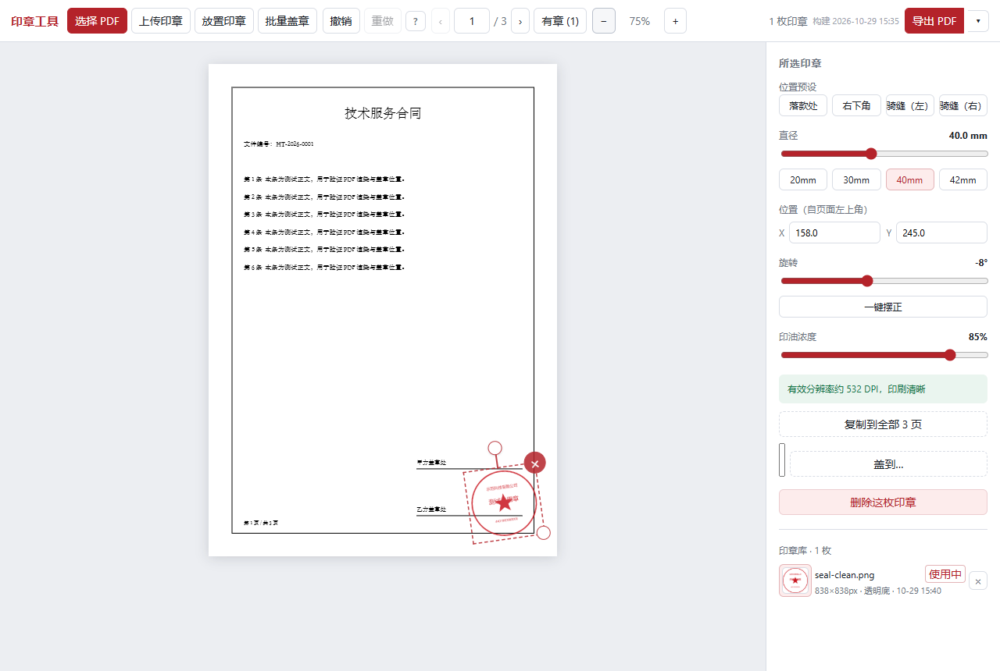
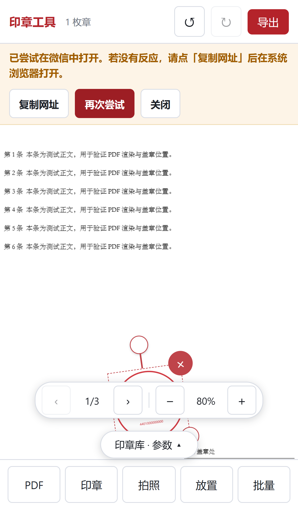

# 印章工具 · Cloudflare Workers 版

把一枚背景透明的公章图片，拖拽 / 缩放 / 旋转后盖到 PDF 的任意位置，导出仍是**原文档 + 一枚图**：文字还是文字、字体还是原字体、矢量零损失。也可以一次给多份 PDF 批量盖章，最后打包成 ZIP。

界面与核心实现参照桌面版 `stamp-tool`，改为部署在 **Cloudflare Workers（Workers Assets）** 上的纯静态网页。所有处理都在浏览器本地完成，**PDF 与印章不会上传到任何服务器**。

> 本目录是 Cloudflare Worker 版源码备份，与 `stamp.logicc.top` 线上部署使用同一份代码；Worker 名称 `stamp-tool`。



## 本地开发

```bash
npm install
npm run dev          # Vite 开发服务器（默认 5173）
```

## 构建与部署到 Cloudflare

```bash
npm run build        # tsc -b && vite build → dist/
npm run cf:dev       # 先构建，再用 wrangler 在本地跑 Worker（默认 8787）
npm run deploy       # 先构建，再 wrangler deploy
```

首次部署前先登录：

```bash
npx wrangler login
```

`wrangler.jsonc` 已配置：

- `assets.directory = ./dist`：由 Worker 直接托管构建产物；
- `not_found_handling = single-page-application`：未知路径回退到 `index.html`；
- 无需数据库、KV、R2 或任何服务端绑定。

> `pdf.js` 的 `cmaps/` 与 `standard_fonts/` 会在构建时由 `vite.config.ts` 的插件复制到 `dist/`，否则带中文子集字体的 PDF 会缺字。部署时不要漏掉这两个目录。

## 功能

- **PDF 盖章**：拖入 PDF 与印章图片，拖动位置、拖右下角缩放、拖顶部圆点旋转；
- **物理尺寸**：印章按 PDF point 存储，界面以 mm 显示，默认 40mm 法定公章直径；
- **位置预设**：落款处 / 右下角 / 骑缝（左·右）；
- **精确控制**：X/Y 毫米输入、旋转角度、印油浓度、20/30/40/42mm 快捷尺寸；
- **撤销/重做**：快照栈，拖拽与滑杆按一次交互记一次历史；
- **多页**：复制到全部页，或按 `1,3,5-8` / `末页` 盖到指定页；
- **批量盖章**：多份 PDF 用同一枚章、同一套规则逐份处理，输出一个 ZIP；含数字签名的文件会跳过；
- **印章库**：导入后存进 IndexedDB，下次打开直接选用；支持改名、清理重复、参数记忆；
- **本地优先**：不请求后端，不上传文件；导出使用 pdf-lib 在原内容流追加 drawImage。

## 移动端 / 微信导出

手机导出不是在生成 PDF 后立刻调 `navigator.share`：读文件、pdf-lib 盖章会耗掉 transient user activation，分享面板必被拒。现在改为**先存住已生成的字节，再让用户点一次「保存 / 分享」**：

- iPhone / Android 浏览器：点击后弹系统分享面板，可存到「文件」或发送到微信；分享不可用时回退新标签页/下载。
- 微信内置浏览器：明确提示「点右上角 ··· → 在浏览器打开」，同时提供「尝试保存」和「复制网址」；不会谎报已保存。
- 微信里批量导出的 ZIP 走同样的两步交付与提示。
- 旧版微信 / 老 iOS 若没有 `CompressionStream`，PNG 编码自动退回 stored-deflate，导出仍能完成。
- 桌面端导出后保留「手动保存」按钮：浏览器或安全软件拦截自动下载时还有一次带用户手势的兜底。



## 架构要点

| 文件 | 作用 |
|---|---|
| `src/lib/pageSpace.ts` | 显示空间 ↔ PDF 用户空间（含 /Rotate、CropBox、UserUnit） |
| `src/lib/exporter.ts` | 导出：签名检测、图片嵌入去重、追加 drawImage |
| `src/lib/pdfReader.ts` | pdf.js 预览、按需渲染、采集页面几何 |
| `src/lib/seal.ts` / `sealPixels.ts` | 印章去白边、去纸背、裁剪到墨迹边界 |
| `src/lib/png.ts` | 自写极简 PNG 编码器（透明区颜色可控；无 CompressionStream 时 stored-deflate 兜底） |
| `src/lib/platform.ts` | 移动端 / 微信 / iOS / Android 判定 |
| `src/lib/sealStore.ts` | IndexedDB 印章库、内容指纹去重、LRU 淘汰 |
| `src/lib/batch.ts` / `zip.ts` | 批量页码规则与极简 ZIP 写出 |
| `src/state/reducer.ts` | 纯 reducer：撤销栈语义 |
| `wrangler.jsonc` | Cloudflare Workers 静态资源部署配置 |

## 测试

```bash
npm test
```

覆盖坐标映射、导出矩阵、PNG 编码（含旧内核兜底）、ZIP、批量页码、撤销栈、印章去重、微信/移动端判定等 149 条纯逻辑用例。

## 说明

- 桌面版原有的 Tauri 打包、Android 打包与本地 Python 验收脚本没有迁移；本项目只保留可在浏览器 / Cloudflare Workers 上运行的部分。
- 默认导出走浏览器下载；支持 File System Access 的浏览器可使用「另存为…」自选位置。
- 清空站点数据会同时清空 IndexedDB 里的印章库。
